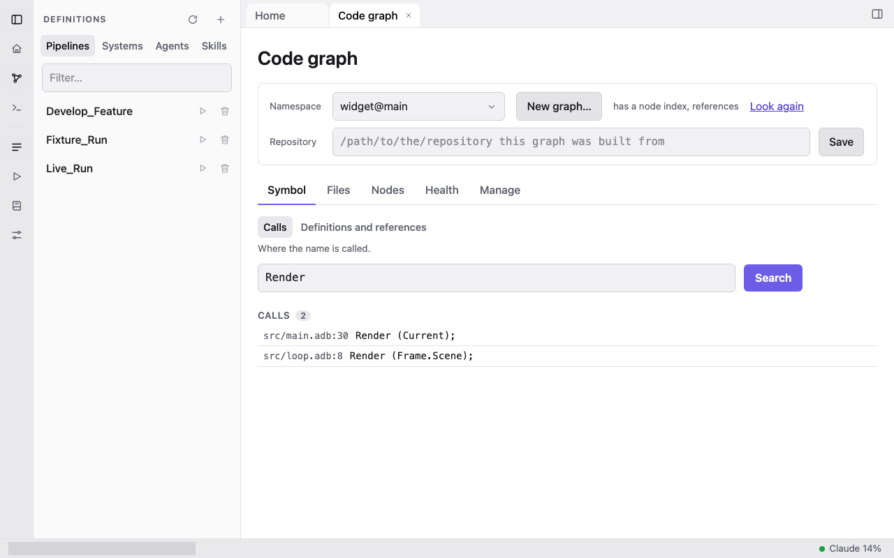

# Code graph

A code graph describes a repository as nodes: notes in the vault that each cover a part of the code and say what it does. Synapse also keeps an index of the repository's symbols, so it can say where a name is defined and where it is called. The Code graph page searches all of this, checks a graph against its repository, and builds, rebuilds or deletes graphs. Open it with the branching icon on the rail.

For what a code graph is and how it is built, see [Synapse code graph](../synapse/synapse-graph.md).

## Choose a graph

Each graph is named by its namespace, `<repo>@<branch>`, for example `widget@main`. The Namespace list at the top holds every graph this machine has local files for, and the app remembers the one you chose. Beside it, the page says what that graph has here: a node index, references, tags. A search that needs something the graph does not have is greyed out, and says why when you point at it. Click "Look again" after a graph was built or changed outside the app.

## Save the repository

The Repository row holds the folder of the repository the graph was built from. Type the folder and click "Save". The app checks the folder and shows the branch it is on. Health and Manage need this folder.

A folder on another branch than the graph's makes every node look out of date, so the page warns about it, and offers a checkout on the graph's branch when it finds one beside the folders you saved for other graphs.

## Search a symbol

Open the Symbol tab and choose one of two searches:

- Calls: every place where the name is called.
- Definitions and references: where the name is defined, and everything that refers to it.

Type the exact name, such as `Work_Dir`, and click "Search". A name that is not in the graph is said to be. On the command line the same searches are [`synapse callers`](../synapse/cli.md#synapse-callers) and `synapse callers --all`.

## Find a file and the node that covers it

Open the Files tab, type some words of a path and click "Search", or press Enter. Pick a file from the results to see the node that claims it, and click the node to open it in the vault.

## Browse the nodes

The Nodes tab lists every node of the graph. Click one to open its note in the vault. Below the list, the page counts the files that no node claims, and lists them when you open the count. On the command line, see [`synapse query`](../synapse/cli.md#synapse-query) and [`synapse index`](../synapse/cli.md#synapse-index).

## Check the graph against its repository

The Health tab compares the graph with the repository you saved. It has a tile for each check, with its count:

- Stale nodes: nodes whose files no longer match what they were written from.
- Drift: what changed since the commit each node was built at.
- Not grounded: nodes whose evidence no longer matches the files.

Click a tile to see what the check found, and click a node to open it. "Check again" reads the repository again. A graph that needs attention also shows on the [Home page](home.md).

## Build a new graph

Click "New graph…" beside the namespace and type the folder of the repository. The app checks the folder and finds the namespace it is on. If that namespace has a graph already, it points to it instead. Otherwise it asks first, then opens a session of a harness in the folder, which builds the graph with the `/synapse-init` skill. You can follow and answer that session on the [Terminals](terminals.md) page.

## Rebuild, delete or clean up

The Manage tab changes a graph. It needs the repository saved first.

- Rebuild with an agent: asks first, then opens a session of the default harness, or of the one you choose, in the repository, with the rebuild command as its first prompt.
- Delete this graph: shows what goes, asks first, and removes the graph from the vault. Notes written by hand in its nodes are kept.
- Clean up deleted branches: removes the graphs of this repository whose branch is gone upstream, after showing them and asking.
