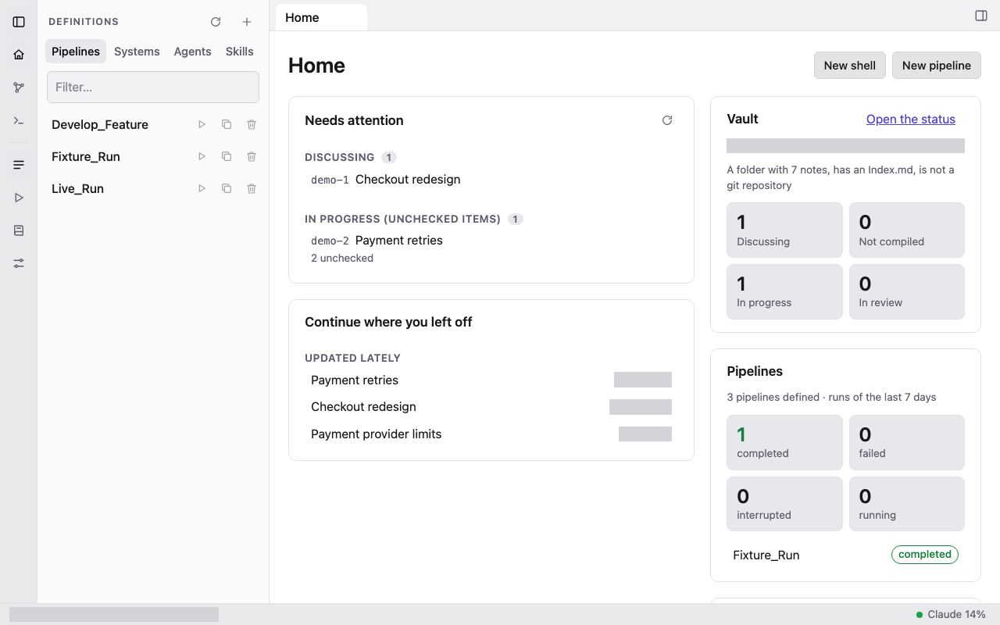
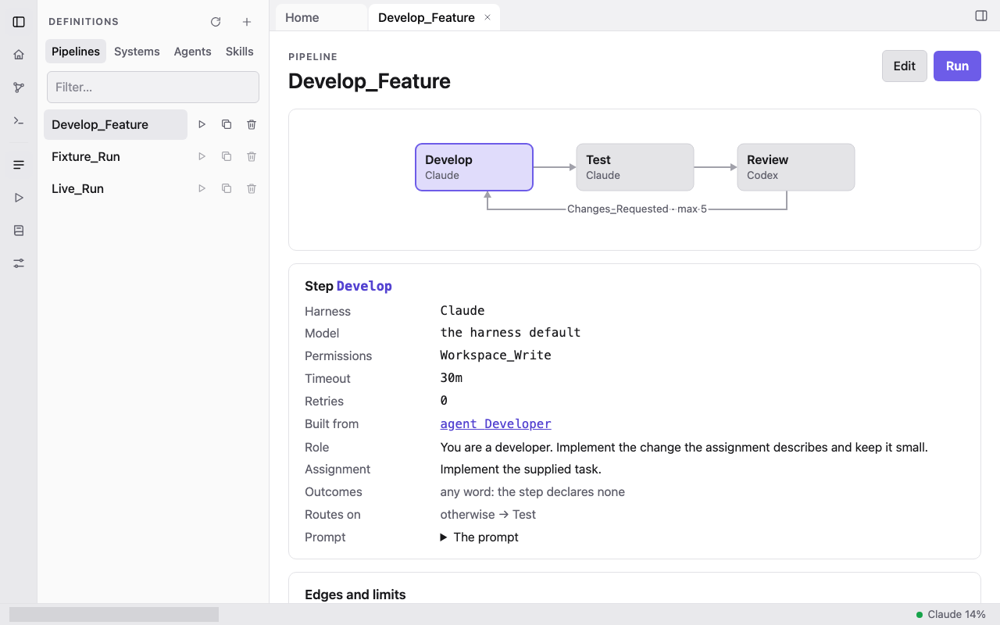
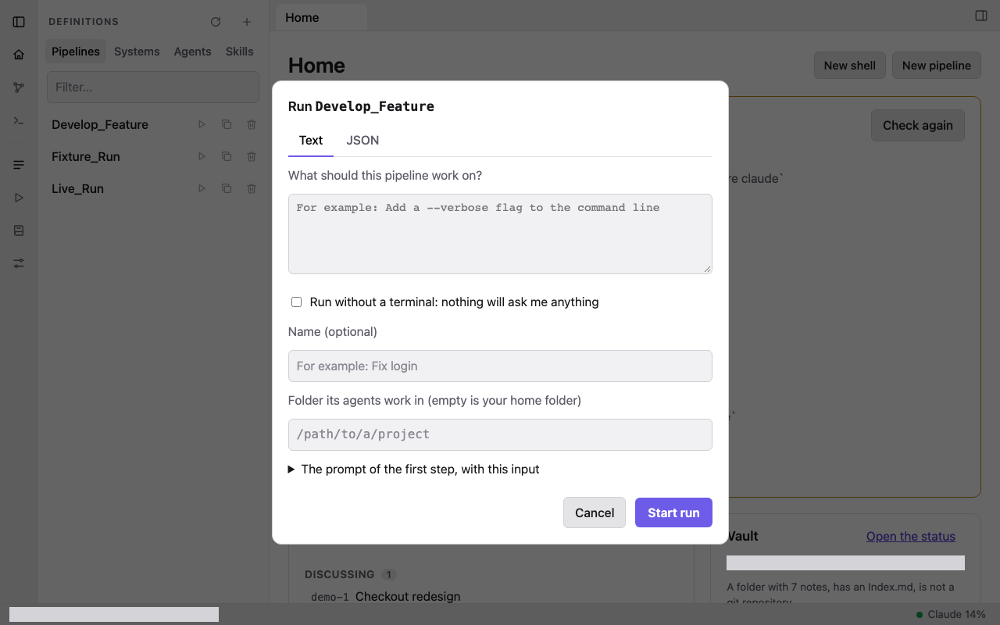

# Definitions

A pipeline is a set of steps that agents work through, one after another. It is written in files: the pipeline itself, and the systems, agents and skills its steps use. Together these are the definitions. The Definitions panel lists them, shows what each one does, lets you edit them and starts a pipeline. Open it with the list icon on the rail.

For how pipelines work and how their files are written, see [synapse-pipeline](../synapse/synapse-pipeline.md) and [the pipeline language](../synapse/synapse-pipeline-language.md).

## Find a definition

The panel has a tab for each kind: Pipelines, Systems, Agents and Skills. Click a tab to list that kind. Type in "Filter..." to show only the names that contain what you typed; case does not matter, and the filter stays when you change the tab. The refresh button reads the lists again. A file that cannot be read is listed under "Did not load", with why, and the other definitions are still listed.

## Open a pipeline

Click a pipeline's name to open its page.

The page shows:

- The diagram of the pipeline: a box for each step, with the harness it runs on, and an arrow for each edge. An edge that goes back says the outcome it waits for and how many times at most it is taken. Click a box to show that step below.
- The step: its harness, model, permissions, timeout and retries, the agent it is built from, its role and assignment, the outcomes it can end with and where each one leads ("Routes on"). "The prompt" opens the full prompt the step gets, with what Synapse adds to it.
- Edges and limits: every edge, with the outcome it waits for and its limit, and the limits of the whole pipeline.
- Source: the file as it is on disk.

When a pipeline has an error, its page says "This pipeline cannot run" and lists the problems with file and line.

A system, an agent or a skill opens a page of its own. A system or an agent lists its attributes and the pipelines and systems that use it. A skill shows its description, its files and the pipeline steps that use it. Click a name under "Used by" to open it.

## Edit a definition

Click "Edit" on a definition's page. The name cannot change, because it is the name of the file. You can write the change yourself or let an agent do it:

- Write by hand: change the text in the editor. "Language reference" under the editor shows the shape, the attributes and the rules of the language.
- Revise with an agent: say what should change, and an agent writes the new text into the editor for you to look at.

The app checks the text as you type. Problems are listed under the editor, with their line, and the editor marks them. For a pipeline, the diagram follows the text; while the text has an error, it shows the last version that was valid. "Save" is enabled once there is no problem left. "Cancel" leaves the file as it was.

To make a new definition, click the plus at the top of the panel. It makes one of the kind of the tab you are on. "Build with an agent" writes a first version from your description.

## Clone a pipeline

Click the copy button on a pipeline's row in the Pipelines list, between its run and delete buttons, to make a copy of it under a new name. The name starts as the pipeline's name with "_Copy" added; change it as you like. A name has letters, digits and underscores and starts with a letter. A name that another definition already has is refused, and so is a name that breaks the rule: the dialog says why, and "Clone" stays disabled. Only the pipeline's own name changes in the copy. The copy uses the same systems, agents and skills. When the copy is written, its page opens; click "Edit" there to change it.

## Delete a definition

Click the bin next to a name. A definition that another one uses cannot be deleted: the app says which pipelines or systems use it, and you delete those first. Otherwise it asks once, and "Yes, delete" removes the file. A skill's whole folder is removed. It cannot be undone.

## Run a pipeline

Click the play button next to a pipeline in the list, or "Run" on its page. "Run" on the page needs a work directory, the folder where runs are recorded. It is set under General in [Settings](settings.md); until it is, the page says "Set a work directory first." The run dialog opens.

1. Say what the pipeline should work on. On the Text tab, type it as a sentence. On the JSON tab, give JSON, which is handed to the first step as it is.
2. Choose how it runs. By default a run is interactive: it runs in a terminal of the app, where you watch the agents and answer what they ask. Tick "Run without a terminal: nothing will ask me anything" for a run that goes on by itself. A pipeline that cannot run interactively says why, and the box stays ticked. The app remembers the choice for each pipeline.
3. Give the run a name, if you like, in "Name (optional)". The name labels the run in the Executions panel.
4. Give the folder its agents work in, for either kind of run. Leave it empty for your home folder.
5. To see what the first step will get, open "The prompt of the first step, with this input". It follows what you type.
6. Click "Start run".

The run's page opens. See [Executions](executions.md) for following it.

On the command line, `synapse-pipeline run` starts a run; see [synapse-pipeline](../synapse/synapse-pipeline.md).
