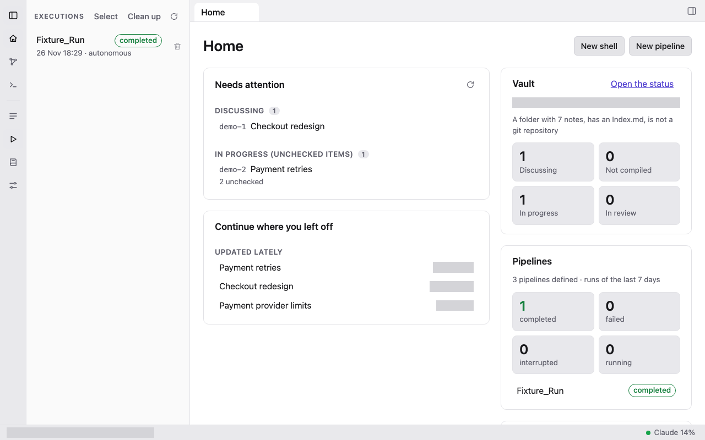
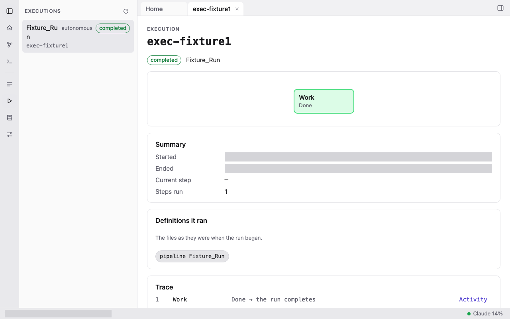
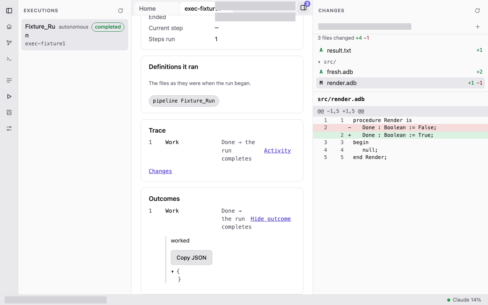

# Executions

An execution is one run of a pipeline. The Executions panel lists the runs, and each run has a page: where it is on its pipeline, what each step did, and what it changed. Open the panel with the play icon on the rail. To start a run, see [Definitions](definitions.md#run-a-pipeline).

## Find a run

The panel lists the runs, the newest first. Each row has the pipeline's name, whether the run was interactive or autonomous, its status, its id and the step it is on. A run that waits for your answer says "needs you". The list follows new runs by itself; the refresh button reads it again now. Click a run to open its page.

## Read a run's page

The page shows, from the top:

- The status of the run and its pipeline. A run that failed says why.
- The diagram of the pipeline, with the run on it: each box says whether the step is running, done (with the outcome it ended with), failed, interrupted or not reached, and how many times it ran. The edges the run took are marked.
- Summary: when the run started and ended, the step it is on and how many steps it ran.
- Definitions it ran: the pipeline and the files it used, as they were when the run began. Click one to read it. The files may have changed since.
- Trace: each visit to a step, in order, with its outcome and the step that came next. "Activity" opens what the agent did in that visit: its messages and the commands it ran. "Changes" opens everything the run changed in the Changes sidebar.
- Outcomes: one row per visit, with its outcome and the step that came next. Open a row to read what the step reported: its summary, the problems a review listed, and its data as a tree that you can fold and copy. The newest visit's row is open. A run recorded by an older version of synapse-pipeline shows "not recorded".
- Events: everything the run recorded, in order.

The page reads the run again while it goes on, so it stays current.

## Follow a running step

A run without a terminal shows a "Running:" card with the step that runs now. The card shows what the agent has done so far and follows it as it goes; scroll up to read back, and it stops following until you scroll down again. When the step ends, the card goes, and the step is in the Trace.

## Answer an interactive step

An interactive run runs in a terminal on its page, under the diagram. It has no tab on the Terminals page. Click in the terminal to type to the agent. "Hide terminal" folds it away, and "Show terminal" brings it back; the session goes on while it is hidden.

When an agent in an interactive step gets stuck, for example on a command it was not allowed to run, it asks in the terminal and waits instead of ending the run. The page then says "Waiting for you.", with what the agent asked, and the run says "needs you" in the panel and on the [Home page](home.md). Answer in the terminal, and the step carries on.

## Stop a run

"Stop run" at the top of the page ends a run that goes on. For an interactive run the app asks first, and its terminal closes with it. A run without a terminal can be stopped only if it was started from this app.

## Review what a run changed

Click "Changes" in the Trace, or open the Changes sidebar with the icon at the top right. The number on the icon is how many files changed.

The sidebar shows everything the run changed in the folder it works in, from the start of the run to its end. While the run goes on, it shows the folder as it is now; "Refresh" reads it again. The files are listed by folder, with the lines added and removed. Click a folder to shut or open it. Click a file to show its diff. A new file is a row that you open to read its content.

A run can change more than one repository. The bar at the top shows the run's folder. Click + and type another repository to add it to the run. The sidebar then shows one group per repository, with its name, how many files changed and the lines added and removed; click a group to shut or open it. An added repository is compared from its last commit at the time you added it, to the end of the run. The cross next to an added repository removes it.

An ended run that has no end snapshot, for example one that was stopped, is shown live: the sidebar says so, and shows the folder as it is now.

A run's page has only its changes: the Git and Activity tabs are there for a terminal session, and so are comments on lines. To comment on what a run changed, open the Changes sidebar of the terminal session you work in. See [Terminals](terminals.md#follow-what-the-agent-does).

On the command line, `synapse-pipeline` shows the same record of a run; see [synapse-pipeline](../synapse/synapse-pipeline.md).
