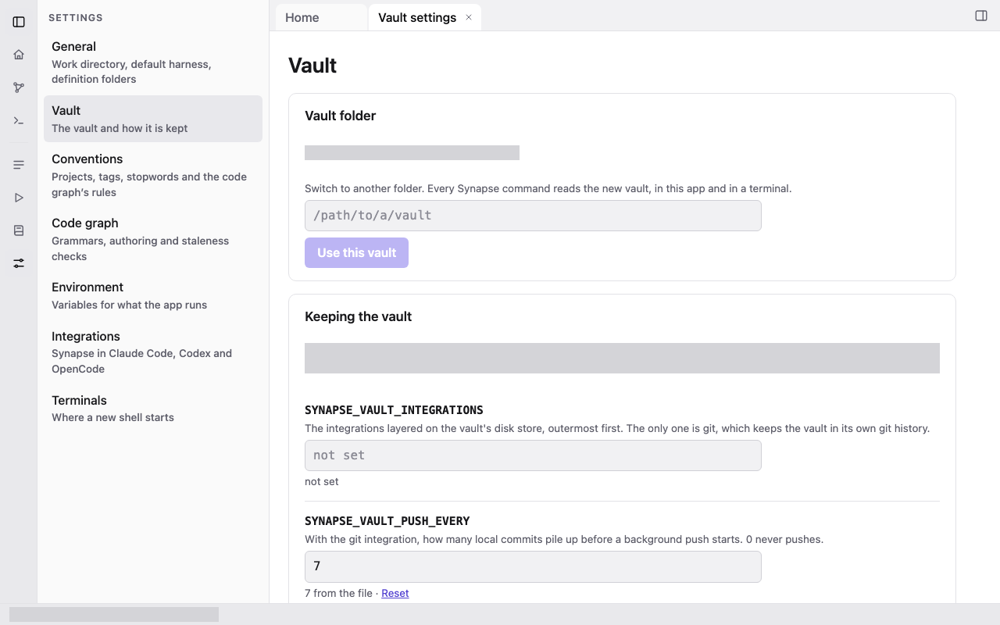
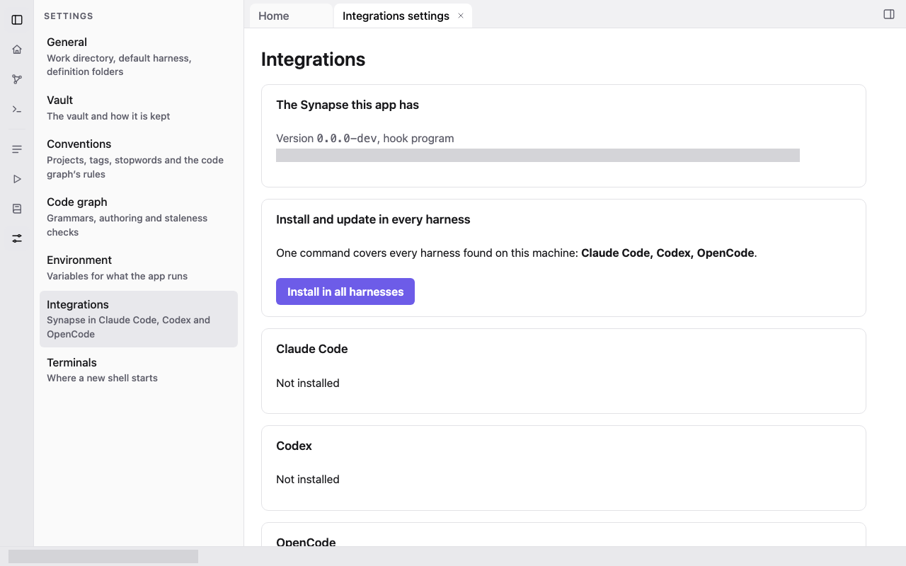

# Getting started

This page takes you from installing Synapse Desktop to a first note and a first pipeline run. Each step links to the page that covers its area in full.

## Install the app

Each release of Synapse has installers for macOS on Apple Silicon, Linux x64 and Windows x64 on its [GitHub Release](https://github.com/imunitic/synapse/releases), with a `SHA256SUMS` file. The release's notes say how to install each one. The short form:

| Platform | Install |
| -------- | ------- |
| macOS | `curl -fsSL https://github.com/imunitic/synapse/releases/latest/download/install.sh \| sh`, or open the `.dmg` and drag the app to Applications |
| Linux | `sudo apt install ./synapse-desktop_<version>_linux-x64.deb`, or run the `.AppImage` (it needs FUSE 2) |
| Windows | Run `synapse-desktop_<version>_windows-x64-setup.exe`. It installs for the current user. |

The installers are not signed with a paid certificate, so your system may warn you the first time:

- macOS: the `curl` install opens without a prompt. A `.dmg` is blocked the first time. Open the app from its context menu, or run this once after copying it:

  ```sh
  xattr -dr com.apple.quarantine "/Applications/Synapse Desktop.app"
  ```

- Windows: SmartScreen asks for a confirmation the first time. Choose "More info", then "Run anyway".

The app brings its own `synapse`, `synapse-hook` and `synapse-pipeline`, of the same version as the app. It needs no Node, Rust or Synapse installed to run.

## First launch

The app opens on its Home page. The rail on the left leads to every area: Home, Code graph and Terminals at the top, then Definitions, Executions, Vault and Settings, which open in the side panel. The tab bar at the top keeps the pages you opened. See [Home page](home.md) for what Home shows.

On a new machine Home says "No vault is chosen." The next step fixes that.

## Choose the vault

The vault is the folder of Markdown notes that Synapse reads and writes. Click "Choose one" on Home, or open Settings and then Vault.



Type the path of the folder into the field under "Vault folder". The app tells you what it finds there: how many notes, whether it has an `Index.md`, and whether it is a git repository.

- The folder is already a vault: click "Use this vault".
- The folder exists but has no `Index.md`: click "Add an Index.md and use it".
- The folder does not exist yet: click "Create this vault".

Every Synapse command reads the new vault from then on, in the app and in a terminal. The same page also sets how the vault is kept, for example in its own git history. See [Settings](settings.md) and, for what a vault is, [Synapse Vault](../synapse/synapse-vault.md).

## Install Synapse into your harnesses

Synapse works inside Claude Code, Codex and OpenCode. Install it there from the app: open Settings, then Integrations.



The page shows the version of Synapse the app has, and one card per harness. Click "Install in all harnesses" to install it in every harness found on this machine with one command. Each card also shows what that harness has now.

The app installs the same version of Synapse it bundles. After the app is updated, it offers to update the harnesses to match. A version installed another way is not supported: one installed by hand with npm, or one newer or older than the app's. The Integrations page shows such a version and offers to replace it with the app's.

Installing runs `npm install -g` and each package's `configure` in a terminal tab, so it needs Node and npm. Without them, a harness you start from the app's [Terminals](terminals.md) page still loads the app's Synapse, for that session only.

## Write a first note

Open Vault from the rail and click "New note" in the side panel. Choose the kind of note: a plain note, a task note or a design note. Describe what the note should say, choose the harness, and click "Write the note". An agent writes it with Synapse's note skills: it picks the folder, adds tags and links to the notes that exist. The note opens when it is written. See [Vault and notes](vault.md) for reading, editing and browsing notes.

## Run a first pipeline

A pipeline is a set of agent steps that run one after another. Open Definitions from the rail, find a pipeline in the list and click its run button. In the run dialog, say what the pipeline should work on and click "Start run". The run opens on its own page, where you can follow each step as it works. See [Definitions](definitions.md) for the run dialog and [Executions](executions.md) for following a run and reviewing what it changed. For pipelines in general, see [Synapse Pipeline](../synapse/synapse-pipeline.md).
