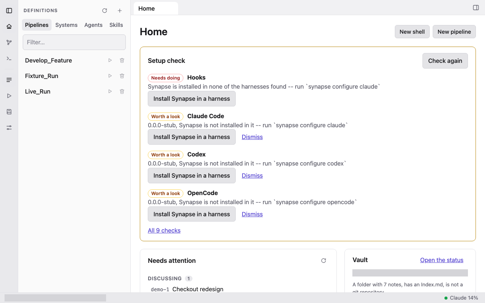

# Home page

Home is where the app opens. It shows what needs you, what is running now, and a card for each part of Synapse: the vault, the pipelines and the code graphs. Open it any time with the house icon at the top of the rail.

The page reads its sources again every 30 seconds, so it stays current while it is open.

## Fix what is not set up

The Setup check card at the top lists what `synapse doctor` found that is not right on this machine: a harness without Synapse, missing hooks, no vault chosen. Each finding has a label: "Needs doing" for something that stops Synapse from working, and "Worth a look" for a warning.

Each finding has a button that fixes it. Most open the settings page that does it, for example "Install Synapse in a harness" opens Integrations. Some show a command instead, with "Copy" and "Open a shell": the app never runs such a command for you. A warning you do not want to see again has "Dismiss". Click "Check again" after you fixed something. When everything is fine, the card is not shown.

For the same checks on the command line, see [`synapse doctor`](../synapse/cli.md#synapse-doctor).

## See what needs attention

The Needs attention card lists, in groups:

- Waiting for you: a pipeline run that waits for your answer in an interactive step.
- Harnesses: a harness that is broken.
- Runs that went wrong: runs that failed or were interrupted lately, with why.
- Code graphs: a graph that no longer matches its repository, if you saved the repository for it on the [Code graph](code-graph.md) page.
- What the vault wants decided: design notes still being discussed, designs that are ready but have no task note yet, tasks in progress with unchecked items, and tasks waiting for review.

Click an entry to open it: a run opens its page, a note opens in the vault, a graph opens its page. The refresh button in the card's corner reads everything again now.

## Pick up where you left off

The Continue where you left off card lists the notes you opened in the app lately, and the notes in the vault that were updated last. Click one to open it. The card is not shown while there is nothing to list.

## Follow what is running

The Running now card lists the pipeline runs that are going, with the step they are on, and the terminals that are open. Click a run to open its page, and a terminal to go to its tab. The card is not shown while nothing runs.

## Read the vault, pipelines and graphs cards

- Vault: the folder of the vault, what it holds, and counts of the notes being discussed, not compiled, in progress and in review. "Open the status" opens the vault's page. With no vault chosen, the card says so and "Choose one" opens the vault settings.
- Pipelines: how many pipelines are defined, how the runs of the last 7 days went (completed, failed, interrupted, running), and the latest runs. Click a run to open it. See [Executions](executions.md).
- Code graph: the graphs this machine has local files for. Click one to search it on the [Code graph](code-graph.md) page.

## Start something new

The two buttons at the top right start work from Home. "New shell" opens a shell on the [Terminals](terminals.md) page. "New pipeline" opens an empty pipeline definition to fill in; see [Definitions](definitions.md).
