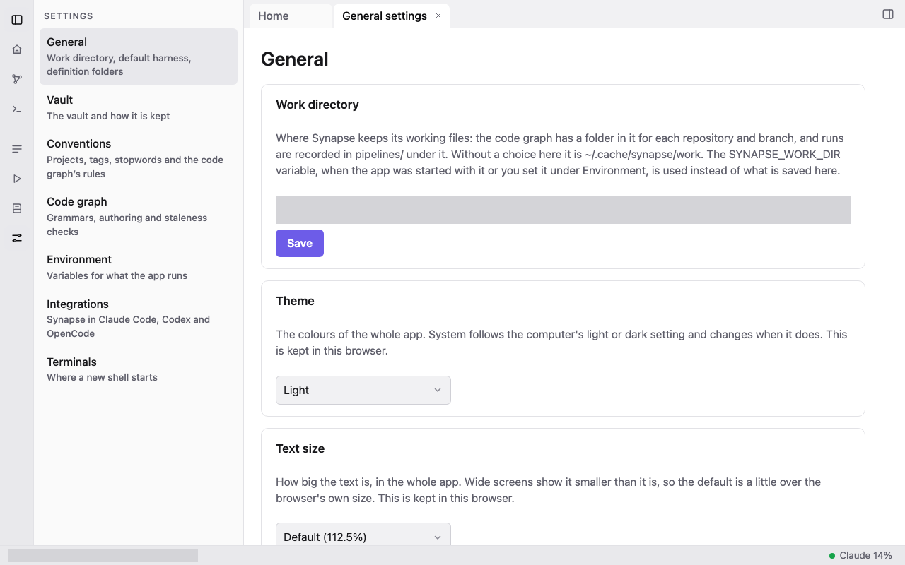

# Settings

Settings is where you tell the app and Synapse where things are and how to work. Open it with the settings icon at the bottom of the rail. The side panel lists the settings pages, each with a line on what it sets. Click one to open it.

Most settings are written to `synapse.conf`, the same file the Synapse commands read in a terminal, so a change here holds there too. A setting is saved when you leave its field or press Enter. A value that does not fit is refused, with the reason under the field; Esc puts back what the file says. "Reset" removes the setting from the file, and the default applies again. Under each setting the page says where its value comes from now: the file, the environment, or the default.

The settings and what each one means are described in [synapse-config](../synapse/synapse-config.md).

## General

- Work directory: where Synapse keeps its working files. The code graph has a folder in it for each repository and branch, and runs are recorded under it. Without a choice it is `~/.cache/synapse/work`. The `SYNAPSE_WORK_DIR` variable, when it is set, wins over what is saved here. Running a pipeline from its page needs a work directory; see [Definitions](definitions.md#run-a-pipeline).
- Theme: light, dark, or System, which follows the computer's setting. It is kept in this app only.
- Text size: how big the text is in the whole app. It is kept in this app only.
- Default harness: the harness (Claude Code, Codex or OpenCode) that writes a definition or a note when you ask an agent to.
- Default models: the model each harness is asked to use when an agent writes a definition or a note for you. Without one, the harness uses its own. A step of a pipeline names its own model in its definition.
- Definition folders: folders of pipeline definitions besides the default one. Their definitions show in the [Definitions](definitions.md) panel.

## Vault

- Vault folder: the vault Synapse reads and writes. Type the path of another folder, or pick one of the recent vaults, and the app says what it finds there: how many notes, whether it has an `Index.md`, and whether it is a git repository. Then use it, add an `Index.md` and use it, or create it, as [Getting started](getting-started.md#choose-the-vault) explains. The path must be absolute.
- Keeping the vault: the settings of how the vault is kept, for example in its own git history.

## Conventions

What Synapse has learned or been told, kept in files on this machine. An agent writes most of it as it works, and you can add an entry or take one out here. Each file is a card; click it to open it. The cards come in three groups:

- Vault: Projects, the projects a task or design note can belong to, and Tag vocabulary, the tags a note may take. The New note page and the note skills read the projects.
- Code graph: the rules the graph is built by, such as which grammar serves each file extension, how a file's namespace and dependencies are found, and which files are left out.
- Prompts: Comment style rules, how comments are to be written in your code, for the agent to follow.

## Code graph

The settings of building and checking the code graph: its grammars, how its nodes are written, and when it checks that a node is out of date. For what the graph is, see [Code graph](code-graph.md).

## Environment

- Environment: variables the app sets for every program it starts, over the ones it was started with. They belong to the app and are not written to `synapse.conf`.
- Variables Synapse reads: each variable, what it does, its default and its value now, with where that value comes from. "Use" puts the variable and its default into the form above, ready to change.

## Integrations

What each harness, Claude Code, Codex and OpenCode, has of Synapse, and the buttons that install or update it. The page shows the version of Synapse the app has, and one card per harness with what it has now. "Install in all harnesses" asks first, naming the command and what it writes, and then runs it in a terminal tab you can watch and stop. It needs Node and npm.

The app installs the same version it bundles. A version installed another way, by hand with npm or newer or older than the app's, is not supported: the page shows it and offers to replace it. See [Getting started](getting-started.md#install-synapse-into-your-harnesses).

## Terminals

- Start folder: where a new shell starts, unless you type another folder on the Terminals page. Empty is your home folder.

The page also says what a shell tab does: it runs your login shell, and in it `claude`, `codex` and `opencode` load the app's Synapse for that run. See [Terminals](terminals.md).
