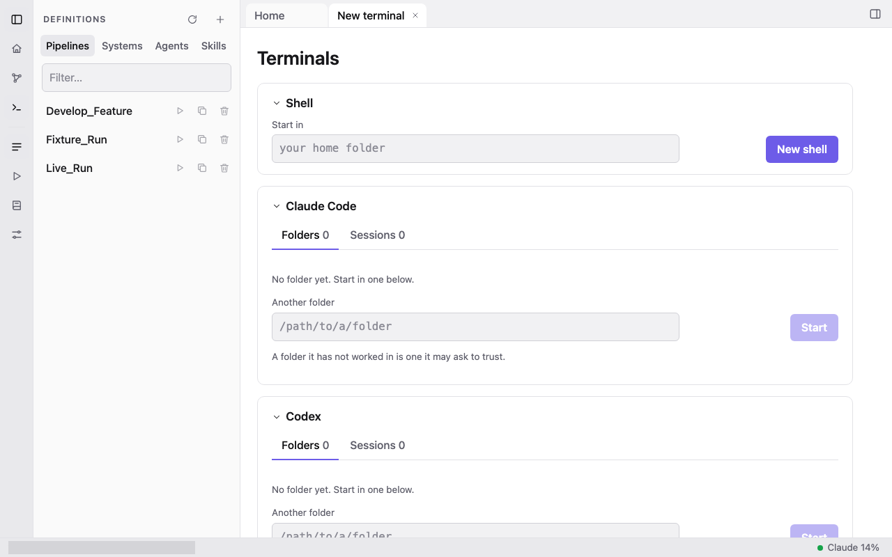

# Terminals

The app hosts terminals: a shell, or Claude Code, Codex or OpenCode started in a folder. A terminal goes on while you look at another page of the app. Open the Terminals page with the prompt icon on the rail.

## Start a shell

The Shell card starts a shell. "Start in" is the folder it starts in; leave it empty for your home folder. The default folder is set in [Settings](settings.md). Click "New shell". "New shell" on the [Home page](home.md) does the same.

## Start a harness in a folder

Each harness has a card: Claude Code, Codex and OpenCode. A harness that is not installed on this machine says "Not found", with why. Click a card's heading to open or shut it; the app keeps each card as you left it.

The Folders tab lists the folders the harness already works in, the newest first. Click a folder to start the harness there. To start in another folder, type it under "Another folder" and click "Start". A harness may ask whether to trust a folder it has not worked in before.

## Resume a past session

The Sessions tab of a harness card lists its past sessions, the newest first, with their title, folder and when they were used. Click "Resume" to continue a session in the folder it was held in. The Changes sidebar of a resumed session shows what is not committed in that folder, since the session's work is already there.

## Synapse in a harness you start here

A harness started from the app has Synapse, even one where it is not installed. When you type `claude`, `codex` or `opencode` in a shell of the app, or start a harness from its card, the app loads its own Synapse into that session only. Nothing is installed in your home folder. A harness that has Synapse installed, for example from [Integrations](settings.md), is started as it is. To install Synapse for every session, see [Getting started](getting-started.md#install-synapse-into-your-harnesses).

## Work with the terminal tabs

Each session has a tab. Click a tab to show it; the others go on. Double-click a tab to rename it, and the name is kept after the app reloads. Drag a tab, or press Alt with the left or right arrow, to put the tabs in another order. The cross on a tab closes it and ends its session. The plus after the tabs opens another shell.

## Follow what the agent does

Open the Changes sidebar with the icon at the top right. For a harness session it has three tabs:

- Changes: what changed in the session's folder. The bar at the top shows the folder; click + and type another repository to show its changes next to it, as a second group. The cross next to it hides it again.
- Git: the commits of the session.
- Activity: the conversation of the harness, in full: your prompts, its messages and the commands it ran. Click a kind of action, such as Commands, to show only those. "Expand all" opens the output of every command. The files the conversation changed stay at the top while you scroll. Click a file to show only what the conversation did to it; click it again to show everything. The file's current state is in the Changes tab.

The Activity tab follows a harness you start from a card, and one you type in a shell. See [Executions](executions.md) for the Changes sidebar in more detail.

A pipeline run that runs in a terminal does not have a tab here: it shows on the run's own page. See [Executions](executions.md).
