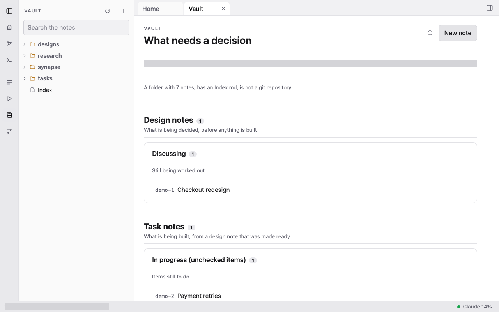
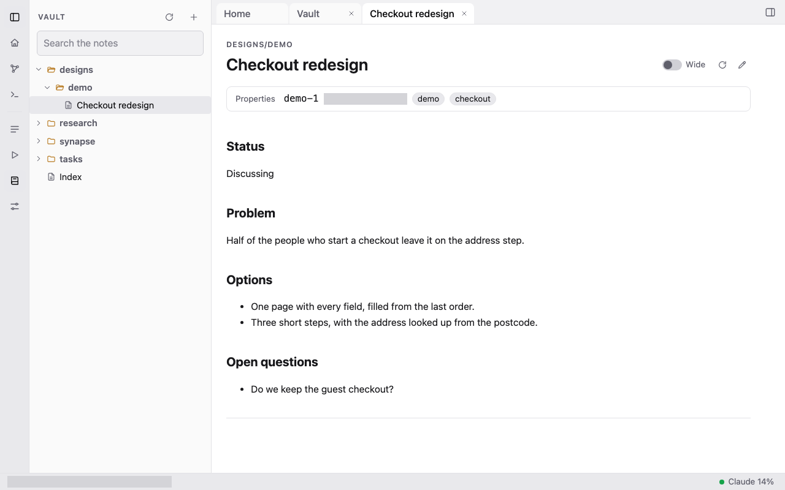
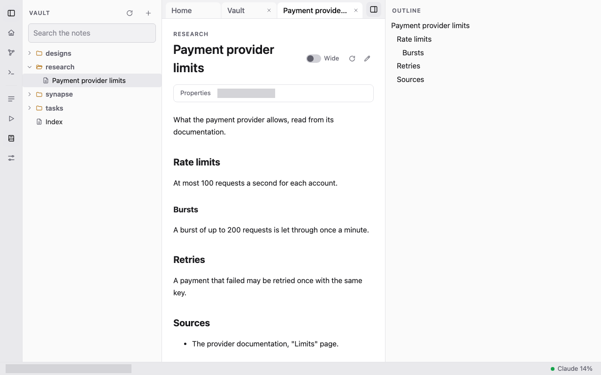

# Vault and notes

The vault is the folder of Markdown notes that Synapse reads and writes: designs, tasks, research and what agents have learned. The Vault area shows what in it needs a decision, lets you browse and read every note, and has an agent write or change a note for you. Open it with the vault icon on the rail. To choose the vault, see [Getting started](getting-started.md#choose-the-vault).

## See what needs a decision

The Vault page, titled "What needs a decision", lists the notes that wait for a person: design notes still being discussed, design notes that are ready but not yet turned into a task, open questions, tasks in progress and tasks waiting for review. Each group says what it holds and how many notes are in it. Click a note to open it.

Under the title are the vault's folder and what it is: how many notes, whether it has an `Index.md`, and whether it is a git repository. The page reads the vault again when a note changes; the refresh button reads it now. When nothing waits, it says "Vault is clear — nothing outstanding."

## Browse and search the notes

The side panel shows the vault as a tree of folders. Click a folder to open or shut it, and click a note to open it in a tab.

Type words into "Search the notes" and press Enter to search the text of every note. The results come in two groups: "Exact matches", the notes that have the words, and "Related", notes about the same thing. Clear the field to go back to the tree.

## Read a note

A note's page shows, from the top:

- The folder the note is in, and its title.
- Properties: the note's id, status, when it was updated, and its tags. Click the box to see every property.
- The text of the note. A link to another note opens that note; a link to a note that does not exist is greyed out.
- Links: the notes this note links to. Linked from: the notes that link to it.

"Wide" lets the note use the full width of the page. Each note keeps its own choice. The refresh button reads the note again; the page also does this by itself when the note changes on disk.

A task note has a check beside its title, "Mark as done". Only a person sets a task to DONE: an agent that changes a note is told never to do it. Press the check again to put back the status it had.

## Jump to a section with the Outline

Open the sidebar with the icon at the top right. On a note's page the sidebar is the Outline: the note's headings, nested.

Click a heading to scroll the note to it. Drag the sidebar's left edge to make it wider or narrower.

## Comment on a note and send the comments to an agent

You can comment on a section of a note and have an agent work the comments in. This is how you review a note an agent wrote.

1. Click "Comment" beside a heading in the Outline, or beside the heading in the note. A comment box opens. Write the comment and click "Save", or press Cmd+Enter (Ctrl+Enter on Windows and Linux). Esc or "Cancel" drops it.
2. The comments gather at the bottom of the Outline, with their number. Click the number to list them. Each comment can be edited or removed, and a click on its section scrolls the note to it. A comment whose section is no longer in the note says so. The comments stay when the page is reloaded, but not when the app is closed.
3. Click "Send to agent". One agent run changes the note to answer all the comments. The note's page then shows what the change did, as below. The comments that were sent are removed once the note has changed. If the run fails, they all stay and the sidebar says why.

"Discard" removes all the comments. A node of a code graph has an outline but takes no comments, and two sibling headings with the same title take none either.

## Change a note with an agent

Click the pencil beside the note's title. Write what should change, for example "tick the first item and add a note about why", choose the harness and the model, and click "Change the note". The agent changes only this note, with Synapse's skills, and nothing is asked of you while it works.

While it works, a line says which harness it is, for how long it has worked and what it does now. "Show activity" lists what it has done. "Stop" ends the run.

When the agent is done, the note is read again, and a card says what the change did: how many lines were added and removed. "Show what changed" shows the lines. "Undo" puts the note back as it was; it refuses if the note was changed again since. If the agent moved other notes, which it was told not to, the card names them.

A node of a code graph has no pencil: the graph writes its nodes itself.

## Make a new note

Click the plus at the top of the side panel, or "New note" on the Vault page. Choose the kind of note:

- Note: any note to keep, such as research, an idea or something learned.
- Task note: a tracked task, with a status and a checklist.
- Design note: a design discussion, written down as it stands.

A task or design note belongs to a project. Choose one of the projects in the list, add a new one there, or leave "Let the agent decide" and the agent picks one of the projects that exist. The agent never adds a project itself.

Describe the note, choose the harness and the model, and click "Write the note". The agent writes it with Synapse's note skills: it picks the folder, adds tags and links to the notes that exist. Nothing is asked of you while it works, and "Stop" ends it with no note written. The note opens when it is written. If the agent could not write it, the page says why and keeps what you typed.

## Learn more

The notes, their folders and their kinds are described in [Synapse Vault](../synapse/synapse-vault.md). The properties each kind of note has are listed in [the note schema](../synapse/synapse-note-schema.md). The vault folder and how the vault is kept are set in [Settings](settings.md#vault).
